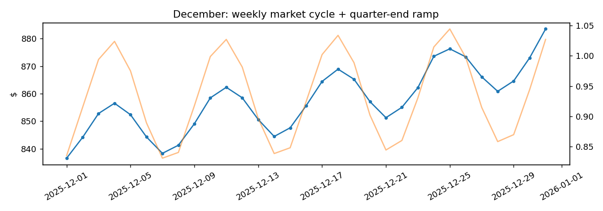
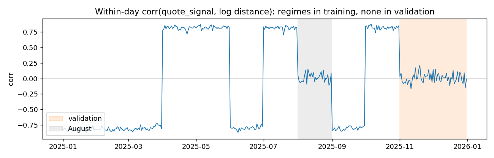

# Freight Rate Forecasting

Forecasts truck-load freight rates (`posted_rate`) two months ahead. The task brief is in [`docs/freight-rate-ml-assessment.pdf`](docs/freight-rate-ml-assessment.pdf). The model is a ridge regression plus gradient boosting, validated on time-based splits.

| | |
| --- | --- |
| **Code** | [`freight_rate_model.ipynb`](freight_rate_model.ipynb): EDA → cleaning → validation → final model → predictions |
| **Predictions** | [`validation_predictions.csv`](validation_predictions.csv): 12,000 Nov–Dec loads, `load_id,predicted_rate` |
| **Fixed-lane forecast** | [`december_chart_predictions.csv`](december_chart_predictions.csv): Lexington → Fort Wayne, 360 mi, Dry Van, 32,000 lb, every day of December |

## Results

Time-based holdout (train Jan–Aug, test Sep–Oct), scored under conditions that mimic the forecast period:

| Model | MAPE (clean rows) | MAE (clean rows) | MAPE (all rows) |
| --- | --- | --- | --- |
| Baseline: median $/mile by equipment × distance band | 3.82% | $82.8 | 6.32% |
| Ridge regression on log $/mile | 2.59% | $54.6 | 5.11% |
| **Ridge + gradient boosting hybrid (final)** | **1.34%** | **$31.7** | **3.87%** |

- **Backtest:** the hybrid averages **1.33%** when each month from Jun to Oct is predicted from the months before it.
- **New cities:** loads touching cities never seen in training score 1.61%.
- **Rows:** "clean rows" excludes the ~1.4% of suspected corrupted labels, flagged using each split's training window only (this selects exactly the same rows as flagging on all labelled data, so no holdout leakage). "All rows" includes them and is the stricter number.



*December forecast for the fixed lane. Blue: predicted rate in $ (left axis). Orange: daily market index (right axis). The rate follows the weekly market cycle and ramps up into quarter end.*

## Run it on Google Colab

[](https://colab.research.google.com/github/kkipngenokoech/freight-rate-forecasting/blob/main/freight_rate_model.ipynb)

1. Click the badge above to open the notebook in Colab.
2. Choose **Runtime → Run all**.
3. Wait about 3 minutes. The notebook downloads its input data from [`data/`](data/) in this repo, and at the end `validation_predictions.csv` and `december_chart_predictions.csv` download to your computer.

Input files in [`data/`](data/):

- `train-test.csv`: labelled loads, Jan–Oct 2025
- `validation.csv`: unlabelled loads to forecast, Nov–Dec 2025
- `validation-predictions-template.csv`: `load_id` order for the output
- `december-chart-inputs.csv`: fixed-lane rows for December

Colab already has every library the notebook needs, so nothing needs installing.

<details>
<summary>Run locally instead</summary>

From a clone of the repo:

```bash
python -m pip install -r requirements.txt
python -m nbconvert --to notebook --execute --inplace freight_rate_model.ipynb
```

</details>

## Approach

### Validation design

The loads to forecast (Nov–Dec 2025) come after all the labelled data (Jan–Oct), so every split is by time and none is random:

- The main holdout trains on Jan–Aug and tests on Sep–Oct, which matches the real two-month horizon.
- A rolling backtest predicts each month from Jun to Oct using only earlier data.
- In the unseen-city check, 8 cities are removed from training.

### Data issues found and handled

| Issue | Handling |
| --- | --- |
| ~1.4% suspected corrupted labels (0.2–0.45× or 2.2–5.4× the expected rate, with an empty gap between them and the normal rows) | Flagged with a first-pass model; excluded from training |
| Negative weights | Sign flipped. These rows price like normal loads. |
| Weight capped at 47,500 lb | Value kept; cap flag added |
| Missing `market_index` | Filled with that day's mean. It is a daily level plus small noise. |
| 8 cities in the forecast period not in training | Location modelled through lat/lon; routed to a geography-only model |
| **`quote_signal` leaks the label in training but is noise in the forecast period** | **Dropped** (see below) |

### The `quote_signal` trap

- Globally, `quote_signal` looks useless. Within each day, though, it tracks $/mile closely, and the direction of that relationship flips every few weeks.
- In August and throughout Nov–Dec, the relationship is gone.
- A model that keeps it scores slightly worse on the holdout (1.35% against 1.34%), and its error rises to 1.51% once `quote_signal` is shuffled within each day to mimic Nov–Dec. So it is excluded.



### Model

The model predicts log $/mile in two stages:

1. **Ridge regression** captures the effects that must extend beyond the training dates:
   - distance curve
   - market index
   - equipment and weight
   - time trend (+0.6% per month)
   - origin and destination city
   - a 5-week quarter-end ramp for each equipment type (rates rise into every quarter end, and December is one)
2. **Gradient boosting** fits what's left after the ridge. Its inputs are geography, daily market level, day of week, days to quarter end, and a shrunk per-lane effect. It gets no raw date, so the trend stays with the ridge.

Loads touching a city not seen in training use a twin model without city effects. Only scikit-learn is required.

### Limitations

- The time trend is extended two months past the data.
- The month-to-month level, which jumps at each quarter start, is the largest remaining source of error.
- One year of data cannot capture holiday effects.

## Repository layout

```text
├── freight_rate_model.ipynb        # full pipeline, outputs saved
├── validation_predictions.csv      # Nov–Dec forecasts
├── december_chart_predictions.csv  # fixed-lane December forecast
├── figures/                        # EDA, diagnostics, December forecast
├── data/                           # input CSVs
├── docs/                           # task brief (PDF)
└── requirements.txt
```
